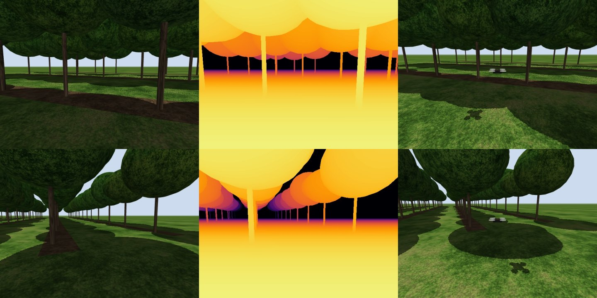
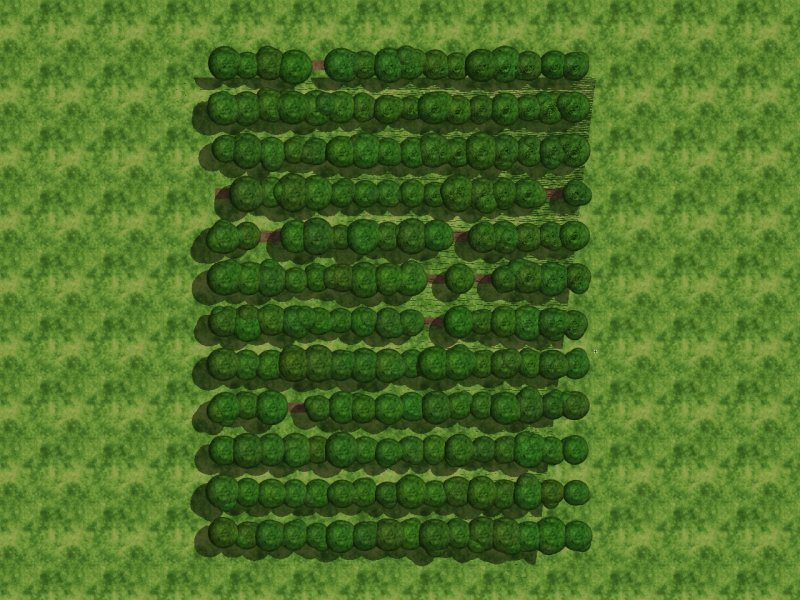

# OrchardScout

**Camera-only drone exploration of an orchard whose size is unknown.**
A small multirotor flies under the canopy of a procedurally generated orchard with one RGB
camera. From the camera alone it estimates depth (monocular metric depth), tracks its own
motion (visual odometry), maps trunks and free space, explores until it has found the
orchard's edges on every side, and reports how big the orchard is: number of rows, row
length, row spacing and overall extent.

> Status: **work in progress** (proof of concept, November 2026). The whole pipeline runs
> end to end: simulator, depth, odometry, mapping with drift correction, size estimation
> and autonomous frontier exploration with a stop rule. Systematic evaluation on small,
> medium and large orchards is under way; see the [roadmap](#roadmap).


*Left to right: onboard RGB (the only thing the agent sees), simulator depth (evaluation
only), chase camera. Top: inside an alley. Bottom: at the orchard edge.*

## The task

| Requirement | How it is handled |
|---|---|
| Simulated orchard, different every run | Procedural generator: rows, row length, spacings, tree sizes, missing trees and position jitter are random per episode |
| Camera only at run time | One forward RGB camera (640x480, ~90 deg horizontal FOV). No LiDAR, depth sensor, GPS or ground-truth pose |
| Monocular depth | Depth Anything V2 (metric, outdoor, Small), rescaled online from the ground plane |
| Visual odometry | KLT tracking + PnP on metric depth, keyframes, ground-plane attitude constraint |
| Exploration + mapping | Occupancy grid + trunk landmark map; frontier exploration with A*-style (Dijkstra) planning and a safety layer |
| Unknown extent | Only frontiers near mapped trees count; exploration stops when none are left, then rows, spacing and extent are read off the map |

Simulator ground truth (depth, pose, layout) is used **only for evaluation**, never as an
input to the agent.

**One stated prior:** the drone flies at a fixed, known height (1.0 m) held by its flight
controller, as a real multirotor does with a barometer or downward range sensor. The agent
uses that number to fix the metric scale of monocular depth, the way monocular visual
odometry on cars uses the known camera height above the road. No IMU is used.

## How it works

```
RGB ─► Depth Anything V2 (metric) ─► ground-plane rescale ─► metric depth ─┬─► visual odometry (KLT + PnP)
  │                                  (known 1.0 m height)                   │        │ pose
  └─► sky mask, depth-edge mask ───────────────────────────────────────────┘        ▼
                                                                    trunk detection + occupancy grid
                                                                        │       │
                         drift correction: landmark re-sighting  ◄──────┘       ├─► frontier explorer ─► velocity
                         + "row compass" (rows are parallel)                    └─► size estimate (rows, spacing, extent)
```

* **Depth and scale** (`depth.py`, `scale.py`, `perception.py`). The network gets the
  scene's shape right but its scale ~5x wrong (trained on car-height images). Every frame,
  a RANSAC plane is fitted to the bottom 12 % of the image and depth is rescaled so the
  camera sits 1.0 m above it. The band is narrow on purpose: the network compresses depth
  with distance even on flat ground, and a wider band biased the scale by 3-5 %. Sky is
  masked by colour; pixels on depth "ramps" (the network blurs depth edges) are masked.
* **Visual odometry** (`vo.py`). Shi-Tomasi corners spread over a grid, tracked frame to
  frame with pyramidal Lucas-Kanade (seeded by a constant-velocity prediction, with a
  forward-backward check), pose from PnP + RANSAC against the keyframe's 3-D points, then
  Levenberg-Marquardt refinement. Local tracking avoids the mismatches that descriptor
  matching makes between look-alike trees. The ground plane also gives gravity and height
  every frame; they are blended into the pose, so only x, y and heading can drift.
* **Mapping** (`mapping.py`). A 2-D occupancy grid at flight height: every visible point
  frees the line of sight to it (trunks are the only obstacles at flight height and would
  block the ray). Obstacles come only from *trunk detections*: compact vertical clusters of
  points 0.25-1.45 m above ground and within 5 m, corrected for seeing only the trunk's
  front half. Raw points are not trusted as obstacles, because the network bends
  featureless open grass upwards. Detections are fused into trunk landmarks.
* **Drift correction.** (1) Landmark re-sighting: trunks seen again are matched to the
  map (gate 0.6 m along rows, 1.2 m across) and the pose is pulled towards them
  (translation only: a rotation fitted to a few close trunks is too noisy). (2) Row
  compass: rows are straight and parallel, so the grid orientation of recently seen trees
  must equal the orientation frozen from the first mapped trees; the heading is pulled
  back to it. This removes most heading drift from turns at the headlands.
* **Size estimation** (`size_estimation.py`). Grid orientation from neighbour directions;
  rows as peaks of the trees' cross-row coordinate; length from runs of >= 3 trees along
  each row (ghost detections cannot stretch it); row and tree spacing measured inside
  single frames, where drift cannot affect them; width = (rows - 1) x row spacing.
* **Exploration** (`explore.py`). 360-degree look-around, then nearest-frontier
  exploration on a 0.4 m planning grid (inflated obstacles, unknown space passable at a
  cost, Dijkstra). A frontier is relevant only within 5 m of a mapped tree, so open field
  beyond the outer rows stops attracting the drone; when no relevant frontier is left the
  orchard is fully seen and the run ends. A safety layer stops or backs the drone away
  from any trunk seen at least twice, and paths are re-checked every step.

## Simulator

[MuJoCo](https://mujoco.org). The original plan was Isaac Lab on Isaac Sim, but Isaac Sim
needs an RTX GPU and the development machine has a GTX 1650 (4 GB). The agent only ever
receives RGB frames, so the perception, mapping and exploration code does not depend on
the simulator and can move to Isaac Lab or PX4 on an RTX machine.

* **Orchard** (`orchard.py`): rows along one axis, trunks as cylinders, crowns as three
  overlapping ellipsoids, a bare-soil strip under each row, open grass around. Textures are
  generated procedurally from noise (`textures.py`); no downloaded assets.
* **Drone** (`sim.py`): velocity-commanded, acceleration-limited body with yaw, at a fixed
  altitude below the canopy; roll and pitch follow acceleration through a first-order
  attitude lag, plus noise. Collisions are checked exactly against trunks and crowns.
* **Rendering**: offscreen OpenGL with sun shadows, sky and fog, ~17 ms per 640x480 frame.

| Parameter (drawn per episode) | Range |
|---|---|
| Rows | 4-20 (presets: small 4-6, medium 8-12, large 14-20) |
| Row length | 20-120 m (small 20-35, medium 40-70, large 80-120) |
| Row spacing | 3-6 m |
| Tree spacing in a row | 1.5-4 m, and at most 0.8 x row spacing |
| Trunk radius | 7-15 cm |
| Canopy base height | 1.7-2.3 m (flight height 1.0 m) |
| Missing trees / position jitter | 5 % / 12 cm (std) |
| Start pose | random alley, or 2-5 m outside a random edge; heading uniform |



## Results so far

Numbers below come from scripted test flights (the drone is steered along the alleys with
simulator ground truth, a test harness; the agent itself sees only the camera). Results of
the autonomous exploration on several orchards will replace them.

**Monocular depth** (16 frames, medium orchard; `scripts/eval_depth.py`). After the
ground-plane rescale, AbsRel is 0.08 at 0-2 m, 0.10 at 2-5 m and 0.15 at 5-10 m, against
~4 for the raw network. Beyond 10 m the network compresses depth (0.3-0.5 AbsRel), so the
map uses depth only to 5 m (obstacles, trunks) and 8 m (free space).


*RGB | ground-truth depth | prediction after rescaling | relative error (blue 0 %, red >= 50 %).*

**Visual odometry** (three alleys of a medium orchard with two headland turns, 171 m;
`scripts/eval_vo.py`):

| Depth used | Final position error | Heading error | ATE (RMSE) | Path scale |
|---|---|---|---|---|
| simulator depth (upper bound) | 0.18 m (0.11 %) | 0.1 deg | 0.10 m | 1.00 |
| monocular network depth | 0.30 m (0.17 %) | 1.7 deg | 0.58 m | 0.98 |

**Mapping and size** (lawnmower over every alley of a small orchard, 151 m;
`scripts/eval_mapping.py`):

| Depth / pose | Rows | Length | Width | Row spacing | Trunk position error |
|---|---|---|---|---|---|
| simulator depth / true pose | 6 / 6 | -0.0 % | -1.3 % | -1.3 % | 1.4 cm |
| network depth / true pose | 6 / 6 | +0.2 % | -0.6 % | -0.6 % | 6.1 cm |

The fully camera-only result (network depth and odometry pose) is being stabilised: it
recovers 6 / 6 rows with length and width within ~5 % in most runs, but a bad headland
turn can still break it (see engineering notes).

## Engineering notes (what did not work, and why)

* **fp16 is 3-4x slower than fp32** on a GTX 1650 (no tensor cores): 136 ms vs 472 ms per
  frame at input 518.
* **Plane-fit band:** fitting the ground in the bottom 28 % of the image put depth 3-5 %
  too short at 0-4 m in flight and made odometry 4 % short. The network compresses depth
  even on flat ground, and the plane bends to follow it. Bottom 12 %: 0-2 % error.
* **Joint scale + compression fit** (`a * d^gamma` with plane tilt) was not identifiable:
  tilt and compression trade off. Dropped.
* **Snapping ground pixels to the fitted plane** made heading drift worse: it ties every
  ground point's error to the per-frame plane tilt.
* **Open-field depth:** looking out of the orchard over featureless grass, the network
  bends the ground upward. Raw points therefore never mark obstacles; only trunk-shaped
  clusters do. The same frames drive most of the odometry error during headland turns.
* **Rotation from landmarks** random-walked the heading (0.2 m noise over a 3 m spread is
  ~4 deg). Translation-only landmark correction plus the row compass works.
* **Trunk front-surface bias:** clustering visible points puts a trunk 2r/pi in front of
  its axis, which shortened measured row spacing by ~4 %; corrected per detection.

## Quick start

```bash
python -m venv .venv
# Windows: .venv\Scripts\activate    Linux/macOS: source .venv/bin/activate
pip install torch --index-url https://download.pytorch.org/whl/cu121   # or the CPU build
pip install -r requirements.txt

python scripts/check_env.py                                      # versions, GPU, render test
python scripts/render_orchard.py --size medium --seed 3          # preview images
python scripts/eval_depth.py --size medium --seed 1              # depth vs ground truth
python scripts/eval_vo.py --size medium --seed 2 --alleys 3      # odometry on a scripted flight
python scripts/eval_mapping.py --size small --seed 0             # mapping + size, scripted flight
python scripts/run_explore.py --size small --seed 0 --video      # autonomous exploration
pytest                                                           # 30 tests
```

Add `--depth gt` (and `--pose gt` where available) for diagnostic upper bounds with
simulator depth or pose. On a headless Linux machine set `MUJOCO_GL=egl` or `osmesa`.

## Repository layout

```
orchardscout/
  orchard.py          procedural orchard layout (ground truth) + MuJoCo geometry
  textures.py         procedural tileable textures
  sim.py              MuJoCo scene, flight model, cameras, collisions
  geometry.py         intrinsics, transforms, back-projection
  depth.py            monocular metric depth (+ per-frame disk cache for experiments)
  scale.py            metric scale from the ground plane and the known flight height
  masks.py            sky and depth-edge masks
  perception.py       per-frame front end: depth, scale, masks, ground normal
  vo.py               visual odometry
  mapping.py          occupancy grid, trunk landmarks, drift correction, row compass
  size_estimation.py  rows, spacing and extent from trunk positions
  explore.py          frontier exploration, planner, safety layer
  control.py          path follower, scripted test routes
  agent.py            everything that runs on the drone, in one step() call
  metrics.py, viz.py  evaluation and figures
scripts/              check_env, render_orchard, eval_depth, eval_vo, eval_mapping, run_explore
tests/                30 tests (layout, geometry, simulator, scale, VO, mapping, size)
```

## Roadmap

- [x] Procedural orchard with randomised, unknown size; ground truth for evaluation
- [x] MuJoCo drone simulator with onboard RGB camera, collisions, ground-truth depth/pose
- [x] Monocular metric depth + online ground-plane scale recovery
- [x] Visual odometry (KLT + PnP on metric depth, ground constraint)
- [x] Occupancy grid and trunk landmark map; drift correction (landmarks + row compass)
- [x] Size estimation: rows, row/tree spacing, length, width
- [x] Frontier exploration with relevance near trees, stop rule and safety layer
- [ ] Results on small / medium / large orchards: size error, coverage, drift, trunk precision/recall, collisions, speed
- [ ] Video and short write-up
- [ ] Extras: robustness to lighting and fog, learned exploration policy, loop closure

## Limitations

* Kinematic flight model with tilt from acceleration, not full rotor dynamics.
* Rasterised rendering looks synthetic; real orchard footage would give different numbers.
* Metric scale relies on locally flat ground and a known flight height.
* The size estimate assumes straight, parallel rows (true of planted orchards, not of
  irregular groves).

## License

MIT
