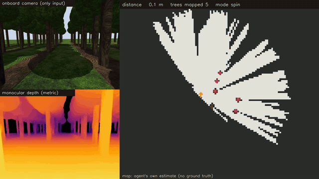
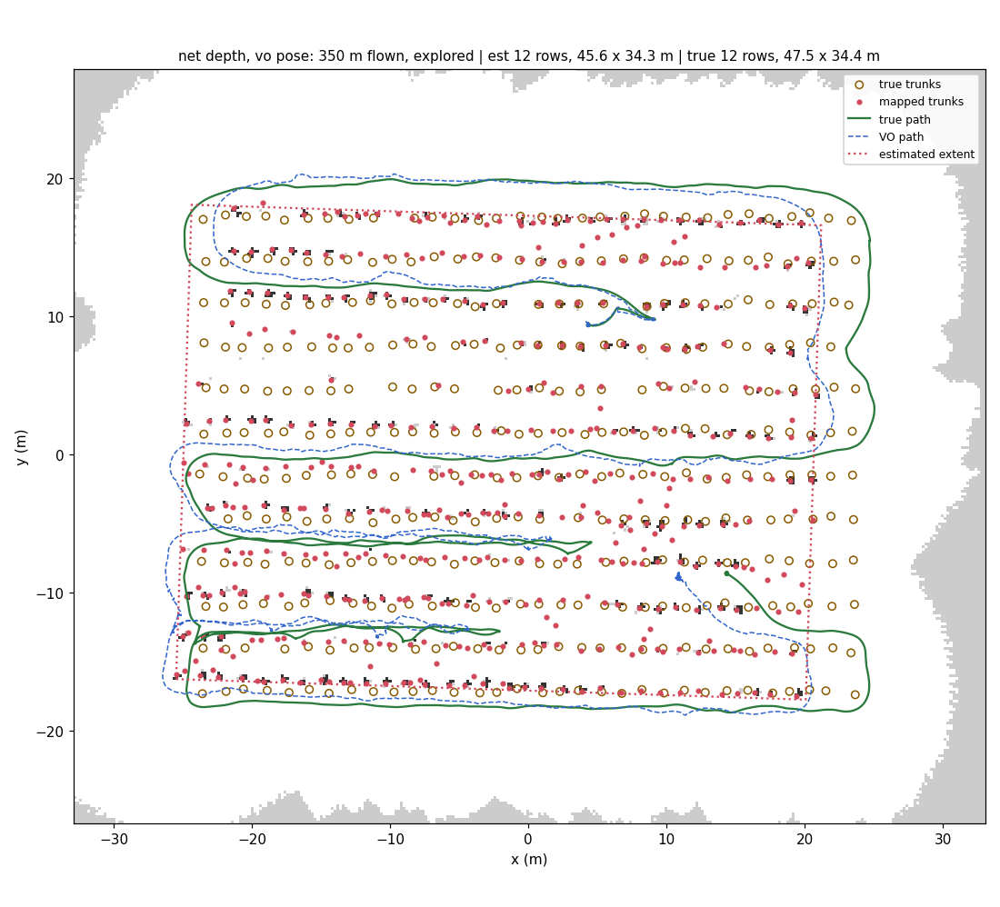
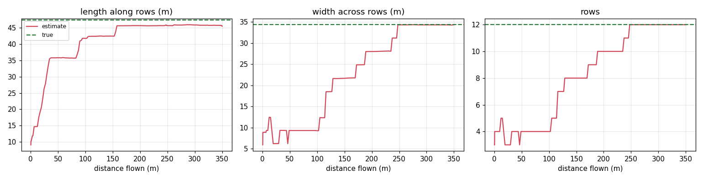
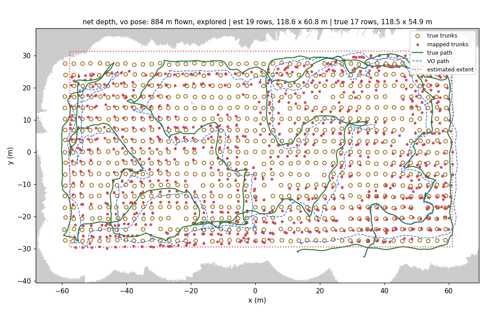
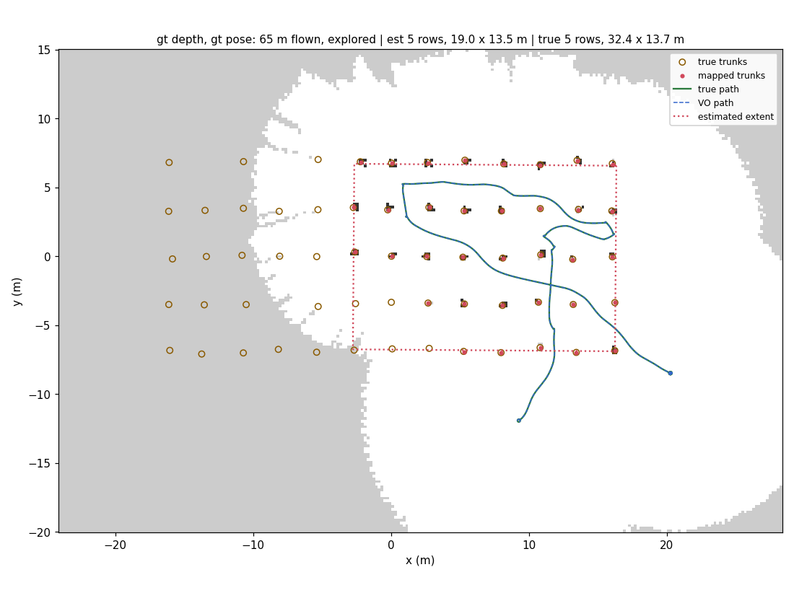
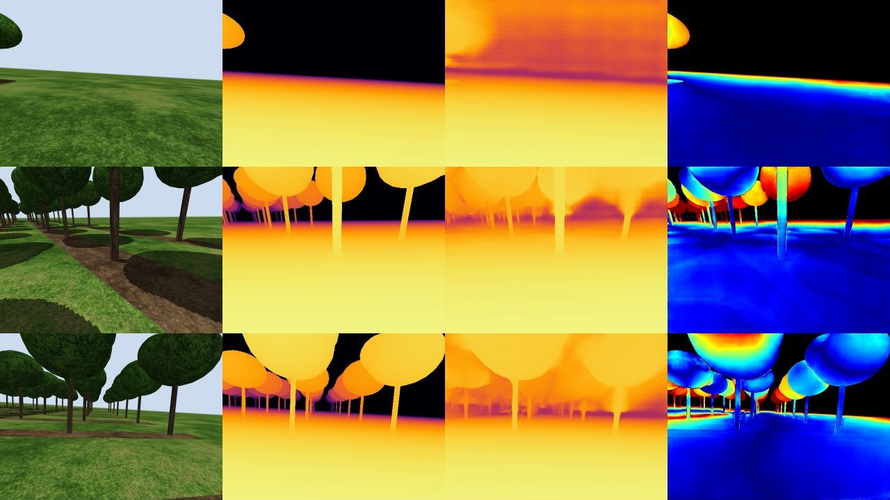

# OrchardScout

**Camera-only drone exploration of an orchard whose size is unknown.**
A small multirotor flies under the canopy of a procedurally generated orchard with a single
RGB camera. From the camera alone it estimates depth, tracks its own motion, maps the trees,
explores until it has seen the orchard's edges on every side (then stops by itself), and
reports how big the orchard is: number of rows, row length, row spacing and overall extent.

**Results (final code, camera only, fully autonomous).** On 10 held-out orchards, in two
rounds of five that were never run before the code was frozen, the drone counted the rows
exactly in 7; it was one row off on two and three rows off on one (a 19-row orchard,
after 1.4 km of flight). Over all 21 orchards, including the 11 used during development:
rows exact in 15 of 21 and never off by more than 3; median error 2.6 % in row length and
6.6 % in orchard width; 99-100 % of every orchard observed; 10.5 km flown and one run
touched a tree (10 s of contact). With perfect depth and pose in place of the camera
pipeline, the same explorer counted the rows exactly in all 21. A revised explorer, tested
afterwards, matched these row counts with no exploration failure at all. Every run, and
every failure with its cause, is below.



*Left: onboard camera (the only input) and the network's metric depth. Right: the agent's
own map: mapped trunks (red), flown path (blue), current plan (green), frontiers (cyan)
and the size estimate (magenta box). 20x real time. Full video (2 min, three orchards): [`docs/media/orchardscout_demo.mp4`](docs/media/orchardscout_demo.mp4).
One-page write-up: [`docs/OrchardScout_writeup.pdf`](docs/OrchardScout_writeup.pdf).*

## The task

| Requirement | How it is handled |
|---|---|
| Simulated orchard, different every run | Procedural generator: rows, row length, spacings, tree sizes, missing trees and position jitter are random per episode |
| Camera only at run time | One forward RGB camera (640x480, ~90 deg horizontal FOV). No LiDAR, depth sensor, GPS, IMU or ground-truth pose |
| Monocular depth | Depth Anything V2 (metric, outdoor, Small), rescaled online from the ground plane |
| Visual odometry | KLT tracking + PnP on metric depth, keyframes, ground-plane attitude/height constraint |
| Explores and builds a map | Occupancy grid + trunk landmark map; frontier exploration with a safety layer |
| Orchard size unknown | Only frontiers near mapped trees count, so exploration stops once the orchard and its edges have been seen; rows, spacing and extent are then read off the map |

Simulator ground truth (depth, pose, layout) is used **only to score runs**, never as an
input to the agent. **One stated prior:** the drone flies at a known height (1.0 m) held
by its flight controller, as real multirotors do with a barometer or range sensor; the
agent uses it to fix the metric scale of monocular depth, the way monocular visual
odometry on cars uses the known camera height above the road.

## Results

Each run is a fresh orchard, a random start (inside an alley or outside an edge, any
heading), and fully autonomous flight until the explorer decides the orchard has been
seen. *Camera only* is the real system. *Perfect depth + pose* replaces the network's depth
and the odometry with simulator ground truth, as an upper bound for the exploration and
size-estimation logic.

**Evaluation protocol.** The code was frozen and run on five orchards it had never seen
(held-out round 1, at the end of this section). That round exposed two failures, so they
were fixed and those five orchards became development orchards. The fixed code (commit
`06541c7`) was frozen again and run on five *new* orchards (round 2). Five more new
orchards (round 3) were generated later to test a revised explorer (end of this section);
the final code was run on them unchanged, so they are a second held-out round for it. Every
number below comes from that final code (the round-3 runs and one other used `4bc91dc`,
which only adds a stall watchdog; see the failure cases), and round 1 is reported as it
happened.

**Held-out orchards, round 2** (never run before the final code was frozen):

| orchard (true size) | start | sensing | rows est / true | length err | width err | row spacing err | flown (m) | coverage | collisions | VO drift | trunk P / R |
|---|---|---|---|---|---|---|---|---|---|---|---|
| small #5: 6 rows, 32 x 23 m | alley | camera only | 6 / 6 | +9.4 % | -4.1 % | -4.1 % | 158 | 100 % | 0 | 1.8 % | 0.28 / 0.44 |
| small #6: 5 rows, 24 x 16 m | edge | camera only | 5 / 5 | +1.4 % | -5.8 % | -5.8 % | 92 | 100 % | 0 | 2.3 % | 0.39 / 0.49 |
| medium #4: 11 rows, 55 x 59 m | alley | camera only | 11 / 11 | +2.1 % | -9.4 % | -9.4 % | 695 | 100 % | 0 | 0.1 % | 0.09 / 0.13 |
| medium #5: 11 rows, 64 x 45 m | edge | camera only | 11 / 11 | +0.9 % | -2.9 % | -2.9 % | 614 | 100 % | 0 | 0.6 % | 0.17 / 0.27 |
| large #2: 19 rows, 92 x 98 m | edge | camera only | 18 / 19 | +3.3 % | -12.1 % | -6.9 % | 1639 | 99 % | 0 | 0.3 % | 0.09 / 0.12 |
| small #5: 6 rows, 32 x 23 m | alley | perfect depth + pose | 6 / 6 | -0.1 % | +0.5 % | +0.5 % | 147 | 97 % | 0 | 0.0 % | 1.00 / 0.76 |
| small #6: 5 rows, 24 x 16 m | edge | perfect depth + pose | 5 / 5 | +0.2 % | -2.0 % | -2.0 % | 123 | 100 % | 0 | 0.0 % | 1.00 / 1.00 |
| medium #4: 11 rows, 55 x 59 m | alley | perfect depth + pose | 11 / 11 | -0.0 % | -0.4 % | -0.4 % | 712 | 100 % | 0 | 0.0 % | 1.00 / 0.94 |
| medium #5: 11 rows, 64 x 45 m | edge | perfect depth + pose | 11 / 11 | -0.0 % | -0.3 % | -0.3 % | 505 | 100 % | 0 | 0.0 % | 1.00 / 0.82 |
| large #2: 19 rows, 92 x 98 m | edge | perfect depth + pose | 19 / 19 | +0.0 % | -0.9 % | -0.9 % | 1658 | 100 % | 0 | 0.0 % | 1.00 / 0.91 |

**Held-out orchards, round 3** (generated and run after the final code was frozen):

| orchard (true size) | start | sensing | rows est / true | length err | width err | row spacing err | flown (m) | coverage | collisions | VO drift | trunk P / R |
|---|---|---|---|---|---|---|---|---|---|---|---|
| small #7: 6 rows, 33 x 27 m | alley | camera only | 6 / 6 | +2.4 % | -8.9 % | -8.9 % | 201 | 100 % | 0 | 2.4 % | 0.24 / 0.35 |
| small #8: 6 rows, 34 x 20 m | edge | camera only | 6 / 6 | -0.8 % | -8.6 % | -8.6 % | 134 | 100 % | 0 | 1.5 % | 0.21 / 0.33 |
| medium #6: 10 rows, 50 x 37 m | alley | camera only | 10 / 10 | -0.1 % | -9.4 % | -9.4 % | 345 | 100 % | 0 | 0.9 % | 0.15 / 0.23 |
| medium #7: 12 rows, 66 x 59 m | edge | camera only | 13 / 12 | +3.1 % | +1.5 % | -6.9 % | 762 | 99 % | 0 | 1.4 % | 0.06 / 0.10 |
| large #3: 19 rows, 89 x 97 m | alley | camera only | 22 / 19 | +4.6 % | +7.2 % | -8.2 % | 1449 | 100 % | 0 | 1.3 % | 0.06 / 0.09 |
| small #7: 6 rows, 33 x 27 m | alley | perfect depth + pose | 6 / 6 | +0.2 % | +0.1 % | +0.1 % | 236 | 100 % | 0 | 0.0 % | 1.00 / 0.94 |
| small #8: 6 rows, 34 x 20 m | edge | perfect depth + pose | 6 / 6 | -0.0 % | -1.1 % | -1.1 % | 146 | 100 % | 0 | 0.0 % | 1.00 / 0.90 |
| medium #6: 10 rows, 50 x 37 m | alley | perfect depth + pose | 10 / 10 | +0.0 % | -0.9 % | -0.9 % | 377 | 100 % | 0 | 0.0 % | 1.00 / 0.94 |
| medium #7: 12 rows, 66 x 59 m | edge | perfect depth + pose | 12 / 12 | +0.0 % | -0.8 % | -0.8 % | 692 | 100 % | 0 | 0.0 % | 1.00 / 0.91 |
| large #3: 19 rows, 89 x 97 m | alley | perfect depth + pose | 19 / 19 | +0.0 % | -0.3 % | -0.3 % | 1312 | 100 % | 0 | 0.0 % | 1.00 / 0.82 |

**Development orchards** (used while building the system, final code):

| orchard (true size) | start | sensing | rows est / true | length err | width err | row spacing err | flown (m) | coverage | collisions | VO drift | trunk P / R |
|---|---|---|---|---|---|---|---|---|---|---|---|
| small #0: 6 rows, 23 x 16 m | alley | camera only | 6 / 6 | +7.4 % | -0.1 % | -0.1 % | 113 | 100 % | 0 | 3.7 % | 0.41 / 0.58 |
| small #1: 5 rows, 32 x 14 m | edge | camera only | 5 / 5 | +0.4 % | -2.3 % | -2.3 % | 122 | 100 % | 0 | 1.9 % | 0.39 / 0.66 |
| small #2: 6 rows, 24 x 27 m | alley | camera only | 6 / 6 | +2.6 % | -8.4 % | -8.4 % | 205 | 100 % | 0 | 1.7 % | 0.16 / 0.24 |
| small #3: 6 rows, 21 x 27 m | alley | camera only | 7 / 6 | +16.3 % | +6.6 % | -11.2 % | 150 | 100 % | 0 | 0.9 % | 0.21 / 0.33 |
| small #4: 6 rows, 28 x 30 m | edge | camera only | 6 / 6 | +13.4 % | -9.6 % | -9.6 % | 268 | 100 % | 0 | 0.5 % | 0.15 / 0.25 |
| medium #0: 12 rows, 47 x 34 m | alley | camera only | 12 / 12 | -4.0 % | -0.0 % | -0.0 % | 350 | 100 % | 0 | 1.0 % | 0.49 / 0.60 |
| medium #1: 10 rows, 68 x 31 m | edge | camera only | 10 / 10 | +0.8 % | -1.9 % | -1.9 % | 341 | 100 % | 0 | 1.3 % | 0.09 / 0.11 |
| medium #2: 12 rows, 49 x 60 m | edge | camera only | 12 / 12 | +12.2 % | -9.4 % | -9.4 % | 509 | 100 % | 0 | 0.8 % | 0.15 / 0.19 |
| medium #3: 12 rows, 45 x 59 m | alley | camera only | 13 / 12 | +14.9 % | -2.4 % | -10.5 % | 435 | 100 % | 0 | 3.0 % | 0.10 / 0.16 |
| large #0: 19 rows, 90 x 56 m | alley | camera only | 19 / 19 | +0.8 % | -1.3 % | -1.3 % | 1041 | 100 % | 100 | 3.9 % | 0.41 / 0.46 |
| large #1: 17 rows, 118 x 55 m | edge | camera only | 19 / 17 | +0.1 % | +10.7 % | -1.6 % | 884 | 100 % | 0 | 0.3 % | 0.13 / 0.14 |
| small #0: 6 rows, 23 x 16 m | alley | perfect depth + pose | 6 / 6 | +0.0 % | -2.7 % | -2.7 % | 93 | 100 % | 0 | 0.0 % | 1.00 / 1.00 |
| small #1: 5 rows, 32 x 14 m | edge | perfect depth + pose | 5 / 5 | -41.3 % | -1.9 % | -1.9 % | 65 | 75 % | 0 | 0.0 % | 1.00 / 0.56 |
| small #2: 6 rows, 24 x 27 m | alley | perfect depth + pose | 6 / 6 | +0.1 % | -1.0 % | -1.0 % | 221 | 100 % | 0 | 0.0 % | 1.00 / 0.98 |
| small #3: 6 rows, 21 x 27 m | alley | perfect depth + pose | 6 / 6 | +0.3 % | -0.3 % | -0.3 % | 166 | 100 % | 0 | 0.0 % | 1.00 / 0.98 |
| small #4: 6 rows, 28 x 30 m | edge | perfect depth + pose | 6 / 6 | -0.1 % | +0.1 % | +0.1 % | 233 | 100 % | 0 | 0.0 % | 1.00 / 0.90 |
| medium #0: 12 rows, 47 x 34 m | alley | perfect depth + pose | 12 / 12 | +0.0 % | -0.9 % | -0.9 % | 323 | 100 % | 0 | 0.0 % | 1.00 / 0.96 |
| medium #1: 10 rows, 68 x 31 m | edge | perfect depth + pose | 10 / 10 | +0.0 % | +0.1 % | +0.1 % | 290 | 99 % | 0 | 0.0 % | 1.00 / 0.80 |
| medium #2: 12 rows, 49 x 60 m | edge | perfect depth + pose | 12 / 12 | +0.1 % | -1.4 % | -1.4 % | 552 | 100 % | 0 | 0.0 % | 1.00 / 0.92 |
| medium #3: 12 rows, 45 x 59 m | alley | perfect depth + pose | 12 / 12 | -0.1 % | -1.1 % | -1.1 % | 521 | 100 % | 0 | 0.0 % | 1.00 / 0.87 |
| large #0: 19 rows, 90 x 56 m | alley | perfect depth + pose | 19 / 19 | +0.0 % | -0.6 % | -0.6 % | 986 | 100 % | 0 | 0.0 % | 1.00 / 0.94 |
| large #1: 17 rows, 118 x 55 m | edge | perfect depth + pose | 17 / 17 | +0.0 % | +0.1 % | +0.2 % | 917 | 100 % | 0 | 0.0 % | 1.00 / 0.84 |

Large #0, camera only: the first attempt livelocked beside a trunk after 585 m (75 % of the
orchard seen) and never finished; the row above is the second attempt. Camera-only runs are
not bit-for-bit repeatable (GPU inference), so the two attempts flew different paths.

Errors are estimate minus truth. *Length*: along the rows, end trunk to end trunk.
*Width*: across the rows, between the outer row centre lines. *Coverage*: share of the
orchard area the map has observed. *Trunk P / R*: precision / recall of mapped trunks
within 0.5 m after a best rigid alignment of the whole map (map shape quality).
*Collisions*: simulation steps (0.1 s each) spent in contact with a tree.

<details>
<summary><b>Held-out round 1</b> (previous code, <code>5e0b4a2</code>): two failures, fixed in <code>06541c7</code></summary>

| orchard (true size) | start | sensing | rows est / true | length err | width err | row spacing err | flown (m) | coverage | collisions | VO drift | trunk P / R |
|---|---|---|---|---|---|---|---|---|---|---|---|
| small #3: 6 rows, 21 x 27 m | alley | camera only | 5 / 6 | -46.4 % | -56.6 % | -47.1 % | 30 | 64 % | 0 | 2.0 % | 0.34 / 0.23 |
| small #4: 6 rows, 28 x 30 m | edge | camera only | 7 / 6 | +13.1 % | +3.7 % | -13.6 % | 269 | 100 % | 0 | 1.0 % | 0.16 / 0.29 |
| medium #2: 12 rows, 49 x 60 m | edge | camera only | 12 / 12 | +5.0 % | -6.0 % | -6.1 % | 578 | 100 % | 0 | 1.4 % | 0.10 / 0.15 |
| medium #3: 12 rows, 45 x 59 m | alley | camera only | 16 / 12 | +13.2 % | +15.2 % | -15.6 % | 659 | 98 % | 0 | 2.8 % | 0.08 / 0.19 |
| large #1: 17 rows, 118 x 55 m | edge | camera only | 17 / 17 | -0.9 % | -1.6 % | -1.6 % | 807 | 100 % | 0 | 0.4 % | 0.12 / 0.13 |
| small #3: 6 rows, 21 x 27 m | alley | perfect depth + pose | 2 / 6 | -57.2 % | -79.9 % | +0.6 % | 15 | 55 % | 0 | 0.0 % | 1.00 / 0.19 |
| small #4: 6 rows, 28 x 30 m | edge | perfect depth + pose | 6 / 6 | +0.0 % | +0.1 % | +0.1 % | 261 | 100 % | 0 | 0.0 % | 1.00 / 0.90 |
| medium #2: 12 rows, 49 x 60 m | edge | perfect depth + pose | 12 / 12 | +0.2 % | -1.0 % | -1.0 % | 529 | 100 % | 0 | 0.0 % | 1.00 / 0.93 |
| medium #3: 12 rows, 45 x 59 m | alley | perfect depth + pose | 2 / 12 | -79.8 % | -91.1 % | -2.5 % | 3 | 15 % | 0 | 0.0 % | 1.00 / 0.04 |
| large #1: 17 rows, 118 x 55 m | edge | perfect depth + pose | 17 / 17 | +0.0 % | +0.1 % | +0.2 % | 917 | 100 % | 0 | 0.0 % | 1.00 / 0.84 |

* **Stopping before the orchard was seen** (small #3 in both modes; medium #3 with perfect
  sensing, after 3 m): with rows 5-6 m apart, every frontier was soon more than 5 m from a
  mapped tree. Fix: frontiers near the start count until the row spacing is measured.
* **Extra rows in wide alleys** (medium #3: 16 instead of 12; small #4: 7 instead of 6): a
  single-frame spacing estimate, biased short, was used early and the row lattice forced it
  onto the map. Fix: only close-range spacing is used, and the drone turns to collect it.

These five orchards were then used to develop the fixes, so they appear again in the
development table above, run with the final code.
</details>


*Camera-only run on a 12-row orchard (47.5 x 34.4 m), plotted against ground truth
afterwards. Green: true path; blue dashes: the agent's own odometry; red dots: mapped
trunks; circles: true trunks; dotted box: the agent's size estimate.*


*The same run: the estimate of length, width and row count against distance flown.*

### Failure cases (final code)

| Run | What happened | Cause |
|---|---|---|
| large #1, #2 and #3 (round 3), camera only | 19 / 17 rows (width +10.7 %); 18 / 19 (width -12.1 %); 22 / 19 (width +7.2 %) | Flights of 0.9-1.6 km. Near the outer edges odometry drift grew past half a row spacing, so the row lattice placed part of an edge row on the next lattice line (extra rows: #1, and #3, which had 19 rows until 1.0 km and then 21 and 22), or the map shrank until two top rows merged (#2). Needs loop closure. |
| small #3, medium #3, medium #7 (round 3), camera only | 7 / 6, 13 / 12 and 13 / 12 rows | Row spacing measured 7-11 % short (wide alleys, where depth is already compressed at 4 m); a shorter spacing fits one more row into the same width. The revised explorer below miscounted all three in the same way. |
| small #1, perfect sensing | stopped with 75 % seen (length -41 %) | Free space is mapped out to 8 m but trunks only to 5 m. Looking down the rows from their last mapped trees pushed the frontier more than 5 m from any mapped tree, so it no longer counted. |
| large #0, camera only, first attempt | livelocked after 585 m | Parked next to a trunk, every new plan began with the same short hop past it, which the safety layer refused. A watchdog (`4bc91dc`) now ends such a run as "stuck". |
| large #0, camera only, second attempt | 10 s in contact with a tree | Not diagnosed: only the number of contact steps was logged. |


*Large #1, camera only (19 rows counted, 17 true). Near the top and bottom edges the
odometry (blue dashes) drifted about 2 m sideways from the true path (green), more than half
the 3.4 m row spacing, and part of each outer row was mapped one row further out.*


*Small #1, perfect depth and pose: the drone mapped the right-hand 19 m of the 32 m rows and
stopped; the unknown area (grey) to the left began just over 5 m from the nearest mapped tree.*

### Tried after the freeze: a revised explorer

After the runs above, the two exploration failures were fixed on branch
[`explorer-v2`](https://github.com/dhruuvsharma/OrchardScout/tree/explorer-v2). Along the rows a
frontier now counts up to 8 m from a mapped tree, because trunks are mapped only within 5 m and
row ends kept slipping out of range. The drone leaves an inflated obstacle only by a hop that
never passes closer to a trunk than it already is, and backs out along the clearest direction
when it gets stuck twice in one place. Every contact with a tree is logged with its time and
duration. It was run, unchanged, on all 21 orchards; round 3 was its held-out set.

| | final code | `explorer-v2` |
|---|---|---|
| Perfect sensing: rows exact | 21 of 21 | 21 of 21 |
| Perfect sensing: least of an orchard seen | 75 % (small #1 stopped early) | 100 % |
| Camera only: rows exact | 15 of 21 | 15 of 21 |
| Camera only, held-out round 3: rows exact | 3 of 5 | 4 of 5 |
| Camera only: large orchards, rows exact | 1 of 4 | 4 of 4 |
| Camera only: small and medium orchards, rows exact | 14 of 17 | 11 of 17 |
| Camera only: largest row-count error | 3 | 2 |
| Camera only: median length / width error | 2.6 % / 6.6 % | 5.2 % / 4.6 % |
| Runs that stopped early, got stuck or touched a tree | 3 (small #1 stopped early; large #0 livelocked, and its re-run touched a tree) | none in 42 |

It fixed what it was built for: in 42 runs it never stopped early, never got stuck and never
touched a tree, and with perfect sensing it saw every orchard completely. With the camera it
counted the rows exactly as often as the final code (15 of 21): better on the large orchards
and on round 3, worse on the small and medium ones. Both versions miss for the same two
reasons (row spacing measured short in wide alleys; odometry drift near the edges of long
flights), and on small #3, medium #3 and medium #7 they made the same mistake. Each orchard
was flown once and camera-only runs are not repeatable, so a difference of a few orchards is
within run-to-run variation. The numbers in this README stay those of the frozen code;
development continues from `explorer-v2`, which removes the exploration failures with the
same row-count accuracy. What the comparison shows is where the limit now is: camera-only
row counting is held back by drift and depth, not by the explorer.

<details>
<summary><b>explorer-v2: every run</b></summary>

Development orchards and held-out round 2:

| orchard (true size) | start | sensing | rows est / true | length err | width err | row spacing err | flown (m) | coverage | collisions | VO drift | trunk P / R |
|---|---|---|---|---|---|---|---|---|---|---|---|
| small #0: 6 rows, 23 x 16 m | alley | camera only | 5 / 6 | +12.7 % | -22.4 % | -3.0 % | 94 | 100 % | 0 | 6.5 % | 0.44 / 0.51 |
| small #1: 5 rows, 32 x 14 m | edge | camera only | 5 / 5 | +5.6 % | -4.1 % | -4.0 % | 143 | 100 % | 0 | 1.2 % | 0.25 / 0.55 |
| small #2: 6 rows, 24 x 27 m | alley | camera only | 6 / 6 | +15.4 % | -7.7 % | -7.7 % | 181 | 100 % | 0 | 2.8 % | 0.15 / 0.23 |
| small #3: 6 rows, 21 x 27 m | alley | camera only | 7 / 6 | +7.4 % | +2.2 % | -14.8 % | 163 | 100 % | 0 | 4.7 % | 0.13 / 0.23 |
| small #4: 6 rows, 28 x 30 m | edge | camera only | 6 / 6 | +1.0 % | -5.2 % | -5.2 % | 181 | 100 % | 0 | 0.3 % | 0.25 / 0.28 |
| small #5: 6 rows, 32 x 23 m | alley | camera only | 6 / 6 | -0.5 % | -4.6 % | -4.6 % | 186 | 100 % | 0 | 0.5 % | 0.38 / 0.69 |
| small #6: 5 rows, 24 x 16 m | edge | camera only | 5 / 5 | +5.2 % | -5.6 % | -5.6 % | 165 | 100 % | 0 | 0.7 % | 0.31 / 0.56 |
| medium #0: 12 rows, 47 x 34 m | alley | camera only | 12 / 12 | -0.1 % | -3.7 % | -3.7 % | 377 | 100 % | 0 | 1.0 % | 0.30 / 0.38 |
| medium #1: 10 rows, 68 x 31 m | edge | camera only | 10 / 10 | +0.5 % | -0.3 % | -0.3 % | 383 | 100 % | 0 | 3.9 % | 0.56 / 0.68 |
| medium #2: 12 rows, 49 x 60 m | edge | camera only | 12 / 12 | +14.3 % | -6.5 % | -6.5 % | 626 | 100 % | 0 | 1.7 % | 0.07 / 0.10 |
| medium #3: 12 rows, 45 x 59 m | alley | camera only | 13 / 12 | +13.9 % | +1.1 % | -7.4 % | 553 | 100 % | 0 | 0.5 % | 0.09 / 0.16 |
| medium #4: 11 rows, 55 x 59 m | alley | camera only | 12 / 11 | +7.9 % | +4.2 % | -5.3 % | 765 | 100 % | 0 | 0.9 % | 0.13 / 0.20 |
| medium #5: 11 rows, 64 x 45 m | edge | camera only | 13 / 11 | +2.8 % | +15.4 % | -3.9 % | 495 | 100 % | 0 | 2.2 % | 0.16 / 0.20 |
| large #0: 19 rows, 90 x 56 m | alley | camera only | 19 / 19 | +4.0 % | +0.3 % | +0.3 % | 1195 | 100 % | 0 | 0.4 % | 0.19 / 0.26 |
| large #1: 17 rows, 118 x 55 m | edge | camera only | 17 / 17 | +1.8 % | -0.5 % | -0.4 % | 879 | 98 % | 0 | 0.4 % | 0.07 / 0.08 |
| large #2: 19 rows, 92 x 98 m | edge | camera only | 19 / 19 | +6.2 % | -5.8 % | -5.8 % | 1387 | 98 % | 0 | 1.1 % | 0.10 / 0.12 |
| small #0: 6 rows, 23 x 16 m | alley | perfect depth + pose | 6 / 6 | +0.2 % | -0.3 % | -0.3 % | 99 | 100 % | 0 | 0.0 % | 1.00 / 0.95 |
| small #1: 5 rows, 32 x 14 m | edge | perfect depth + pose | 5 / 5 | +0.0 % | -0.6 % | -0.6 % | 149 | 100 % | 0 | 0.0 % | 1.00 / 1.00 |
| small #2: 6 rows, 24 x 27 m | alley | perfect depth + pose | 6 / 6 | +0.1 % | -0.2 % | -0.2 % | 229 | 100 % | 0 | 0.0 % | 1.00 / 1.00 |
| small #3: 6 rows, 21 x 27 m | alley | perfect depth + pose | 6 / 6 | +0.3 % | +2.1 % | +2.1 % | 193 | 100 % | 0 | 0.0 % | 1.00 / 0.96 |
| small #4: 6 rows, 28 x 30 m | edge | perfect depth + pose | 6 / 6 | +0.0 % | -0.4 % | -0.4 % | 317 | 100 % | 0 | 0.0 % | 1.00 / 0.96 |
| small #5: 6 rows, 32 x 23 m | alley | perfect depth + pose | 6 / 6 | -0.0 % | -0.3 % | -0.3 % | 178 | 100 % | 0 | 0.0 % | 1.00 / 0.94 |
| small #6: 5 rows, 24 x 16 m | edge | perfect depth + pose | 5 / 5 | +0.3 % | -0.5 % | -0.5 % | 118 | 100 % | 0 | 0.0 % | 1.00 / 0.97 |
| medium #0: 12 rows, 47 x 34 m | alley | perfect depth + pose | 12 / 12 | +0.1 % | -1.2 % | -1.2 % | 383 | 100 % | 0 | 0.0 % | 1.00 / 0.95 |
| medium #1: 10 rows, 68 x 31 m | edge | perfect depth + pose | 10 / 10 | -0.0 % | -0.2 % | -0.2 % | 415 | 100 % | 0 | 0.0 % | 1.00 / 0.87 |
| medium #2: 12 rows, 49 x 60 m | edge | perfect depth + pose | 12 / 12 | +0.1 % | -0.4 % | -0.4 % | 472 | 100 % | 0 | 0.0 % | 1.00 / 0.92 |
| medium #3: 12 rows, 45 x 59 m | alley | perfect depth + pose | 12 / 12 | -0.1 % | -0.6 % | -0.7 % | 491 | 100 % | 0 | 0.0 % | 1.00 / 0.89 |
| medium #4: 11 rows, 55 x 59 m | alley | perfect depth + pose | 11 / 11 | -0.0 % | -0.2 % | -0.2 % | 709 | 100 % | 0 | 0.0 % | 1.00 / 0.94 |
| medium #5: 11 rows, 64 x 45 m | edge | perfect depth + pose | 11 / 11 | +0.0 % | -0.5 % | -0.5 % | 543 | 100 % | 0 | 0.0 % | 1.00 / 0.85 |
| large #0: 19 rows, 90 x 56 m | alley | perfect depth + pose | 19 / 19 | +0.0 % | -1.1 % | -1.1 % | 896 | 100 % | 0 | 0.0 % | 1.00 / 0.93 |
| large #1: 17 rows, 118 x 55 m | edge | perfect depth + pose | 17 / 17 | -0.0 % | -0.2 % | -0.2 % | 929 | 100 % | 0 | 0.0 % | 1.00 / 0.88 |
| large #2: 19 rows, 92 x 98 m | edge | perfect depth + pose | 19 / 19 | +0.0 % | -1.3 % | -1.3 % | 1496 | 100 % | 0 | 0.0 % | 1.00 / 0.92 |

Held-out round 3:

| orchard (true size) | start | sensing | rows est / true | length err | width err | row spacing err | flown (m) | coverage | collisions | VO drift | trunk P / R |
|---|---|---|---|---|---|---|---|---|---|---|---|
| small #7: 6 rows, 33 x 27 m | alley | camera only | 6 / 6 | -2.5 % | -7.9 % | -7.9 % | 247 | 100 % | 0 | 0.4 % | 0.14 / 0.24 |
| small #8: 6 rows, 34 x 20 m | edge | camera only | 6 / 6 | -2.0 % | -4.7 % | -4.7 % | 178 | 100 % | 0 | 1.8 % | 0.13 / 0.22 |
| medium #6: 10 rows, 50 x 37 m | alley | camera only | 10 / 10 | +3.8 % | -4.2 % | -4.2 % | 387 | 100 % | 0 | 1.1 % | 0.10 / 0.17 |
| medium #7: 12 rows, 66 x 59 m | edge | camera only | 13 / 12 | +6.8 % | -2.0 % | -10.1 % | 905 | 99 % | 0 | 1.9 % | 0.06 / 0.10 |
| large #3: 19 rows, 89 x 97 m | alley | camera only | 19 / 19 | +6.2 % | -4.8 % | -4.8 % | 1249 | 100 % | 0 | 0.5 % | 0.06 / 0.08 |
| small #7: 6 rows, 33 x 27 m | alley | perfect depth + pose | 6 / 6 | +0.1 % | -1.5 % | -1.5 % | 237 | 100 % | 0 | 0.0 % | 1.00 / 0.87 |
| small #8: 6 rows, 34 x 20 m | edge | perfect depth + pose | 6 / 6 | -0.7 % | -2.6 % | -2.6 % | 161 | 100 % | 0 | 0.0 % | 1.00 / 0.92 |
| medium #6: 10 rows, 50 x 37 m | alley | perfect depth + pose | 10 / 10 | +0.0 % | -1.2 % | -1.2 % | 352 | 100 % | 0 | 0.0 % | 1.00 / 0.90 |
| medium #7: 12 rows, 66 x 59 m | edge | perfect depth + pose | 12 / 12 | -0.0 % | -0.4 % | -0.4 % | 705 | 100 % | 0 | 0.0 % | 1.00 / 0.82 |
| large #3: 19 rows, 89 x 97 m | alley | perfect depth + pose | 19 / 19 | +0.1 % | -0.9 % | -0.9 % | 1243 | 100 % | 0 | 0.0 % | 1.00 / 0.81 |
</details>

### Component checks

* **Monocular depth** (`scripts/eval_depth.py`, 16 frames, medium orchard). The raw
  network's scale is ~5x off at drone height (AbsRel ~3.9). After the ground-plane rescale,
  AbsRel is 0.09 at 0-2 m, 0.12 at 2-5 m, 0.14 at 5-10 m and 0.3-0.5 beyond 10 m, so trunks
  and obstacles are mapped only within 5 m and free space within 8 m.
* **Visual odometry alone** (`scripts/eval_vo.py`, three alleys of a medium orchard, 171 m,
  no map-based correction): ATE 0.58 m, final error 0.30 m, heading error 1.7 deg with
  network depth; 0.10 m / 0.18 m / 0.1 deg with simulator depth.


*RGB | ground-truth depth | prediction after rescaling | relative error (blue 0 %, red >= 50 %).*

## How it works

```
RGB ─► Depth Anything V2 (metric) ─► ground-plane rescale ─► metric depth ─┬─► visual odometry (KLT + PnP)
  │                                  (known 1.0 m height)                   │         │ pose
  └─► sky, depth-ramp and "rising ground" masks ───────────────────────────┘         ▼
                                                                    trunk detection + occupancy grid
                    drift correction from orchard structure  ◄──────┘        │
                    (row compass, row lattice, landmark re-sighting)         ├─► frontier explorer ─► velocity
                                                                             └─► size estimate (rows, spacing, extent)
```

* **Depth and scale** (`depth.py`, `scale.py`, `perception.py`). Every frame a RANSAC plane
  is fitted to the bottom 12 % of the image and depth is rescaled so the camera sits 1.0 m
  above it. The band is narrow on purpose: the network compresses depth with distance even
  on flat ground, and a wider band biased odometry scale by ~4 %. Sky is masked by colour;
  pixels on depth ramps (the network blurs depth edges) are masked; for odometry, open
  grass that the network bends upwards ("rising ground") is masked too.
* **Visual odometry** (`vo.py`). Shi-Tomasi corners spread over a grid, tracked frame to
  frame with pyramidal Lucas-Kanade (seeded by a constant-velocity prediction,
  forward-backward checked); pose from PnP + RANSAC against the keyframe's 3-D points, then
  Levenberg-Marquardt. Local tracking avoids mismatches between look-alike trees. The
  ground plane gives gravity and height every frame, so only x, y and heading can drift.
* **Mapping** (`mapping.py`). A 2-D occupancy grid at flight height: every visible point
  frees the line of sight to it (trunks are the only obstacles at flight height and would
  block the ray). Obstacles come only from *trunk detections*: compact vertical clusters
  0.25-1.45 m above ground and within 5 m, corrected for seeing only the trunk's front half.
* **Drift correction from orchard structure.** *Row compass:* rows are straight and
  parallel, so straight lines of recently seen trees (RANSAC, >= 3 trees) must keep the
  orientation frozen from the first mapped trees; the heading is pulled back to it.
  *Row lattice:* rows are evenly spaced, so row lines seen now must fall on the lattice;
  the residual (modulo the row spacing, once it has been measured up close) corrects the
  sideways position. *Landmark re-sighting:*
  trunks seen again pull the position back (translation only).
* **Size** (`size_estimation.py`). Grid orientation from tree lines; which axis the rows
  run along is decided by the smaller in-line spacing; rows are peaks of the trees'
  cross-row coordinate; length from runs of >= 3 trees per row; row and tree spacing from
  trunks seen within 4 m over a few seconds (where depth is accurate), and from nothing
  else: until there are enough of these measurements, no spacing is used at all; width =
  (rows - 1) x spacing.
* **Exploration** (`explore.py`). 360-degree look-around, then nearest-frontier
  exploration on a 0.4 m planning grid (Dijkstra; inflated obstacles; unknown space
  passable at a cost; cells far from trees cost more, because monocular depth and odometry
  are worst over open grass). A frontier counts only within max(5 m, 1.5 row spacings) of
  a mapped tree, so open field beyond the outer rows stops attracting the drone. Until the
  row spacing has been measured, frontiers within 12 m of the start count too, and on
  reaching a goal the drone turns a full circle (at most every 8 m) so both neighbouring
  rows come within close range. When no frontier counts any more, the drone looks around
  once more and stops. A safety layer backs away from or stops short of any trunk seen at
  least twice.

## Engineering notes: what did not work, and why

* **fp16 is 3-4x slower than fp32** on a GTX 1650 (no tensor cores).
* **A wide ground band** (bottom 28 %) biased depth 3-5 % short at 0-4 m in flight.
* **Joint fit of scale + depth compression + plane tilt** was not identifiable. Dropped.
* **Snapping ground pixels to the fitted plane** tied every ground point's error to the
  per-frame plane tilt and made heading drift worse.
* **Raw points as obstacles:** over open grass the network bends the ground upwards and the
  whole field became "obstacles". Only trunk-shaped clusters mark obstacles now.
* **Rotation from a few landmarks** random-walked the heading; so did a compass based on
  nearest-neighbour directions during exploration (few trees, odd viewpoints). Robust line
  fits fixed the compass.
* **Flying around the outside** of the orchard (cheapest for the planner) is where depth
  and odometry are worst; paths now prefer staying near trees.
* **Spacing measured in single frames** was 8-16 % short in wide alleys (both rows only
  fit in the image from ~4.5 m, where depth is compressed). Measuring from close trunks
  over a short window fixed it, but held-out round 1 showed that even falling back to
  single-frame values *early in a run* did harm: the row lattice forced the short spacing
  onto the map and created extra rows (16 instead of 12). Now nothing uses the spacing
  until enough close-range measurements exist, and the drone turns to collect them.
* **Stopping before the orchard was seen.** Free space is mapped out to 8 m but trunks only
  to 5 m. With rows 5-6 m apart, after the first look-around every frontier lay more than
  5 m from any mapped tree, so the explorer reported the orchard explored after 3-15 m
  (round 1, even with perfect sensing). Frontiers near the start now count until the row
  spacing is known.
* **Choosing the row axis early** from a small map could pick the wrong axis when tree
  spacing is close to row spacing; it is now revisited until clear.
* **A fixed 5 m relevance radius** missed an outer row when rows were 5.4 m apart. The
  radius now scales with the measured row spacing. This makes the drone fly longer near the
  edges, which costs some accuracy in camera-only runs (more distance, more drift).

## Simulator

[MuJoCo](https://mujoco.org). The original plan was Isaac Lab on Isaac Sim, but Isaac Sim
needs an RTX GPU and the development machine has a GTX 1650 (4 GB). The agent only receives
RGB frames, so perception, mapping and exploration do not depend on the simulator.

* **Orchard** (`orchard.py`, `textures.py`): rows along one axis, trunks as cylinders,
  crowns as three overlapping ellipsoids, a bare-soil strip under each row, open grass
  around; textures are procedural noise, no downloaded assets.
* **Drone** (`sim.py`): velocity-commanded, acceleration-limited body with yaw at a fixed
  altitude below the canopy; roll and pitch follow acceleration through a first-order
  attitude lag, plus noise. Collisions are checked exactly against trunks and crowns.

| Parameter (drawn per episode) | Range |
|---|---|
| Rows | 4-20 (presets: small 4-6, medium 8-12, large 14-20) |
| Row length | 20-120 m (small 20-35, medium 40-70, large 80-120) |
| Row spacing | 3-6 m |
| Tree spacing in a row | 1.5-4 m, and at most 0.8 x row spacing |
| Trunk radius / canopy base | 7-15 cm / 1.7-2.3 m (flight height 1.0 m) |
| Missing trees / position jitter | 5 % / 12 cm (std) |
| Start | random alley, or 2-5 m outside a random edge; heading uniform |

## Reproduce

```bash
python -m venv .venv && .venv\Scripts\activate          # Linux/macOS: source .venv/bin/activate
pip install torch --index-url https://download.pytorch.org/whl/cu121   # or the CPU build
pip install -r requirements.txt

python scripts/check_env.py                                            # versions, GPU, render test
python scripts/run_explore.py --size medium --seed 0 --video           # one autonomous run
python scripts/run_explore.py --size medium --seed 0 --depth gt --pose gt   # perfect-sensing bound
python scripts/summarize.py runs/explore --out runs/explore/summary    # results table
python scripts/eval_depth.py --size medium --seed 1                    # depth vs ground truth
python scripts/eval_vo.py --size medium --seed 2 --alleys 3            # odometry, scripted flight
pytest                                                                 # 35 tests
```

On a GTX 1650 the camera-only agent runs at ~2-3 steps per second with three runs sharing
the GPU (the depth network takes ~135 ms per frame): 12-20 minutes for a small orchard,
35-70 for a medium one and 1-2.5 hours for a large one. Headless
Linux: set `MUJOCO_GL=egl` or `osmesa`.

## Repository layout

```
orchardscout/
  orchard.py, textures.py   procedural orchard (ground truth) + MuJoCo geometry and textures
  sim.py                    MuJoCo scene, flight model, cameras, collisions
  depth.py, scale.py        monocular metric depth; scale from the ground plane
  masks.py, perception.py   sky / depth-ramp masks; per-frame front end
  vo.py                     visual odometry
  mapping.py                occupancy grid, trunk landmarks, drift correction, spacing
  size_estimation.py        rows, spacing and extent from trunk positions
  explore.py, control.py    frontier explorer with safety layer; path follower
  agent.py                  everything that runs on the drone, in one step() call
  geometry.py, metrics.py, viz.py
scripts/   run_explore, summarize, make_video, build_writeup, eval_depth, eval_vo, eval_mapping, ...
tests/     35 tests (layout, geometry, simulator, scale, VO, mapping, size, explorer)
docs/      figures, demo video, one-page write-up
```

## Limitations and next steps

* Simulation only, with rasterised rendering; numbers on real orchard footage would differ.
  Next: Isaac Lab / PX4 on an RTX machine, and real orchard video for the sim-to-real gap.
* No global pose-graph optimisation or loop closure. On the largest orchards (0.9-1.6 km of
  flight) drift near the edges can exceed half a row spacing and add or drop an edge row;
  re-seen rows are the natural loop-closure constraint. The raw trunk map also keeps
  duplicates, which the structure-based size estimate mostly ignores.
* In wide alleys (5 m and more) the measured row spacing can come out 7-11 % short, which
  adds a row. Close-range depth or a learned depth correction for trunks is the fix to try.
* Better exploration alone does not fix row counts: `explorer-v2` (above) removes the early
  stop and the livelock but counts rows no better with the camera.
* Metric scale relies on locally flat ground and a known flight height; the size estimate
  assumes straight, parallel rows (true of planted orchards, not of irregular groves).
* Exploration is classical (frontiers). Natural next steps: a learned exploration policy
  compared against this baseline, and an adversarial "environment agent" that varies
  lighting, fog, row irregularity and terrain to find where camera-only navigation breaks.

## License

MIT
